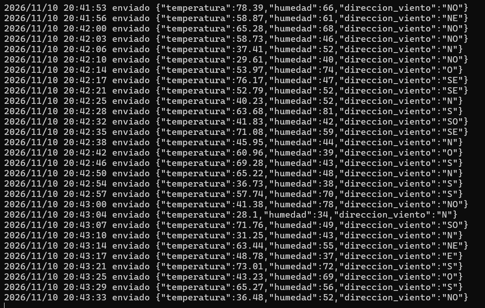
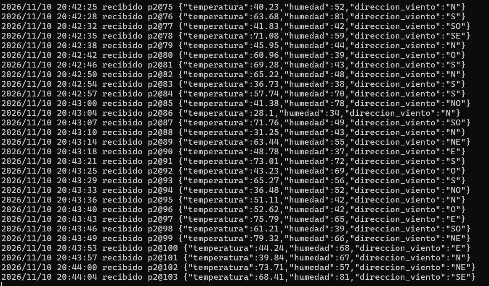
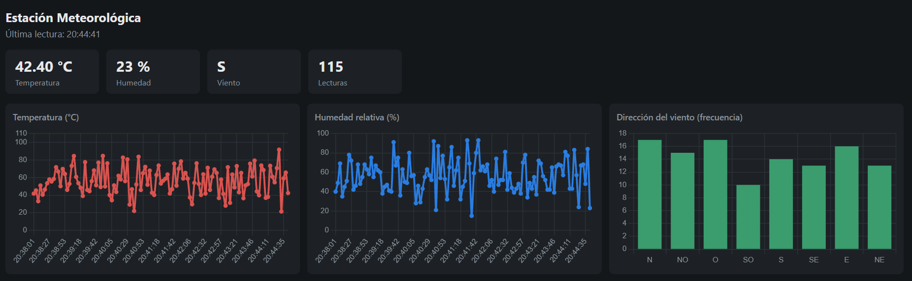

# IoT: Estación Meteorológica

CC3067 Redes - Universidad del Valle de Guatemala

**Integrantes**
- Jose Merida - 201105
- Angel Esquit - 23221

## Descripción

Simulación de un nodo de sensores de una estación meteorológica que envía su telemetría a un servidor Apache Kafka en el borde (Edge), y un consumidor que muestra los datos en gráficas que se actualizan en vivo. Está escrito en Go con la librería [`segmentio/kafka-go`](https://github.com/segmentio/kafka-go).

El proyecto tiene dos programas:

- **Producer** (`cmd/producer`): simula los tres sensores y publica una lectura en el topic cada 15 a 30 segundos. Corre hasta que se interrumpe con Ctrl+C.
- **Consumer** (`cmd/consumer`): se suscribe al mismo topic, guarda las lecturas que llegan y las muestra en un dashboard web con tres gráficas: temperatura, humedad y dirección del viento.

### Datos simulados

| Sensor | Rango | Tipo |
|---|---|---|
| Temperatura | [0, 110] °C | Float con 2 decimales |
| Humedad relativa | [0, 100] % | Entero |
| Dirección del viento | N, NO, O, SO, S, SE, E, NE | Categórico |

La temperatura y la humedad se generan con una distribución normal con media 55 y desviación estándar 15, recortada al rango de cada sensor. La dirección del viento se elige de forma uniforme.

Cada lectura se envía como JSON, por ejemplo:

```json
{"temperatura":56.32,"humedad":51,"direccion_viento":"SO"}
```

### Configuración de Kafka

- **Broker:** `161.35.11.141:9092`
- **Autenticación:** `SASL_PLAINTEXT` con mecanismo `PLAIN`
- **Topic:** `201105` (carné de un integrante), con key `sensor1`
- **Consumer group:** uno nuevo en cada ejecución, leyendo desde el primer mensaje del topic. Así las gráficas incluyen la telemetría pasada y la que va llegando.

## Ejecución

Requiere Go 1.24 o superior y acceso de red al broker.

Abrir dos terminales en la carpeta del proyecto.

**Terminal 1: producer**

```bash
go run ./cmd/producer
```

**Terminal 2: consumer**

```bash
go run ./cmd/consumer
```

Luego abrir <http://localhost:8080> en el navegador. Las gráficas se actualizan cada 3 segundos y se llenan conforme llegan lecturas. Para detener cualquiera de los programas, presionar Ctrl+C.

### Opciones

Ambos programas usan por defecto el topic `201105` y el broker del laboratorio, por lo que no necesitan opciones.

| Opción | Programa | Descripción | Por defecto |
|---|---|---|---|
| `-topic` | ambos | Topic de Kafka | `201105` |
| `-broker` | ambos | Bootstrap server | `161.35.11.141:9092` |
| `-min`, `-max` | producer | Intervalo mínimo y máximo entre envíos (s) | `15`, `30` |
| `-http` | consumer | Dirección del dashboard | `:8080` |
| `-group` | consumer | Consumer group id | uno nuevo por ejecución |
| `-out` | consumer | Archivo CSV donde se respaldan las lecturas (vacío para desactivar) | `lecturas.csv` |
| `-compact` | ambos | Usar el payload de 3 bytes en lugar de JSON (ver abajo) | desactivado |
| `-replay` | consumer | CSV de lecturas a repetir sin conectarse al broker (ver abajo) | vacío |
| `-replay-delay` | consumer | Pausa entre lecturas del replay | `300ms` |

Ejemplo para probar rápido, enviando cada 2 a 3 segundos:

```bash
go run ./cmd/producer -min 2 -max 3
```

## Payload restringido de 3 bytes

Para redes como LoRa o Sigfox el payload máximo es de 3 bytes (24 bits), así que con `-compact` cada lectura se codifica en binario en lugar de JSON. El producer y el consumer deben usar la misma opción, y conviene usar un topic distinto al del JSON para no mezclar formatos:

```bash
go run ./cmd/producer -compact -topic 201105-p2
go run ./cmd/consumer -compact -topic 201105-p2
```

Distribución de los 24 bits:

| Bits | Campo | Codificación |
|---|---|---|
| 23..10 (14 bits) | Temperatura | Entero en centésimas de grado (0 a 11000). Como 2^14 = 16384 > 11000, caben los 2 decimales sin pérdida. |
| 9..3 (7 bits) | Humedad | Entero de 0 a 100 (2^7 = 128) |
| 2..0 (3 bits) | Dirección del viento | Índice 0 a 7 en `N, NO, O, SO, S, SE, E, NE` |

Por ejemplo, `{"temperatura":56.32,"humedad":51,"direccion_viento":"SO"}` (58 bytes en JSON) se envía como 3 bytes. El dashboard y el CSV funcionan igual en ambos modos.

### Probar el codec sin broker

El broker del laboratorio solo estuvo encendido el primer día de la actividad. Para demostrar el codec sin conexión, `-replay` toma las lecturas guardadas en `lecturas.csv`, codifica cada una a 3 bytes, la decodifica de vuelta y la grafica en el dashboard:

```bash
go run ./cmd/consumer -replay lecturas.csv
```

Cada lectura se imprime como `lectura -> bytes en hex -> lectura decodificada`, y al final se informa cuántas quedaron idénticas tras el viaje de ida y vuelta. Con las 414 lecturas de `lecturas.csv`, todas quedaron iguales. Esto prueba la codificación, pero no el envío por Kafka: el modo `-replay` no usa el broker. La codificación está en `internal/codec` y tiene tests (`go test ./internal/codec/`).

## Estructura

```
cmd/producer/       # Kafka Producer: envía una lectura cada 15-30 s
cmd/consumer/       # Kafka Consumer + servidor HTTP con gráficas en vivo
  dashboard.html    # Página del dashboard (Chart.js)
internal/sensor/    # Generación pseudoaleatoria de datos
internal/codec/     # Encode/Decode del payload de 3 bytes
internal/kafkacfg/  # Broker y autenticación SASL
```

El consumer recibe los mensajes en una goroutine y los guarda en memoria. Al mismo tiempo sirve `dashboard.html` (incluido en el binario con `go:embed`) y los datos en `/api/data`. El dashboard consulta ese endpoint cada 3 segundos y redibuja las gráficas.

## Capturas de pantalla

### Producer enviando datos



### Consumer recibiendo datos



### Dashboard con las gráficas


